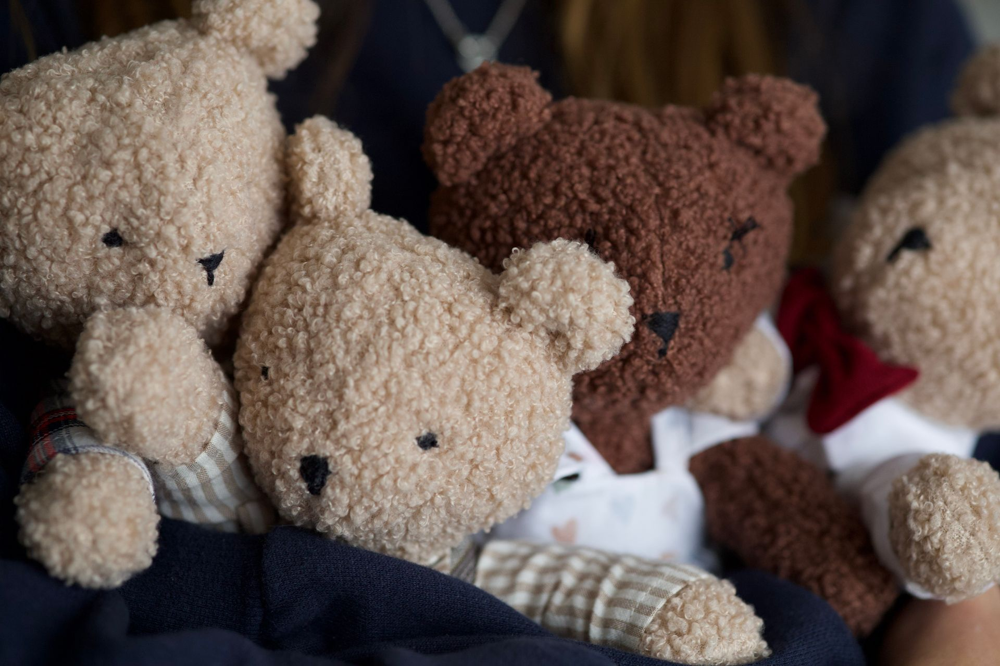

# Teddy Tales

A boutique website for **Teddy Tales** — teddy bears, character plush, polyboa and super-soft fabrics, made in Rithala, New Delhi.



## Pages

- `index.php` — homepage, collections, material library and material notes
- `about.php` — the Teddy Tales story, values and milestones
- `products.php` — full catalogue with category filters
- `gallery.php` — lookbook and lightbox gallery
- `contact.php` — wholesale, sample and bespoke enquiries

## Run locally

1. Place the project inside your XAMPP `htdocs` folder.
2. Start **Apache** from the XAMPP control panel.
3. Open `http://localhost/teddy/` in your browser.

The site is plain PHP with Tailwind loaded from a CDN — there is no build step or package install required.

## Project structure

```text
teddy/
├── index.php
├── about.php
├── products.php
├── gallery.php
├── contact.php
├── config.php
├── seo.php
├── includes/
│   ├── head.php
│   ├── header.php
│   ├── footer.php
│   ├── product-tile.php
│   └── icon.php
└── assets/
    ├── css/style.css
    ├── js/main.js
    └── images/
```

## Notes

- Product photography is stored locally under `assets/images/premium/`.
- The site uses a softened apricot/copper palette with Cormorant Garamond display type and Inter body type.
- The transparent Teddy Tales logo is used in the header, preloader and footer, with a light variant for dark backgrounds.
